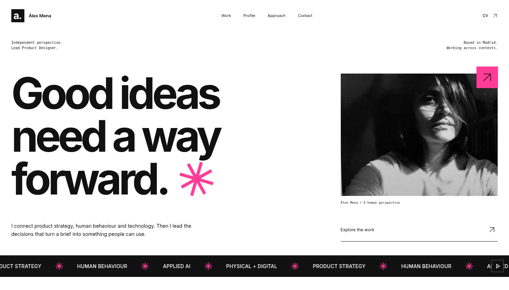
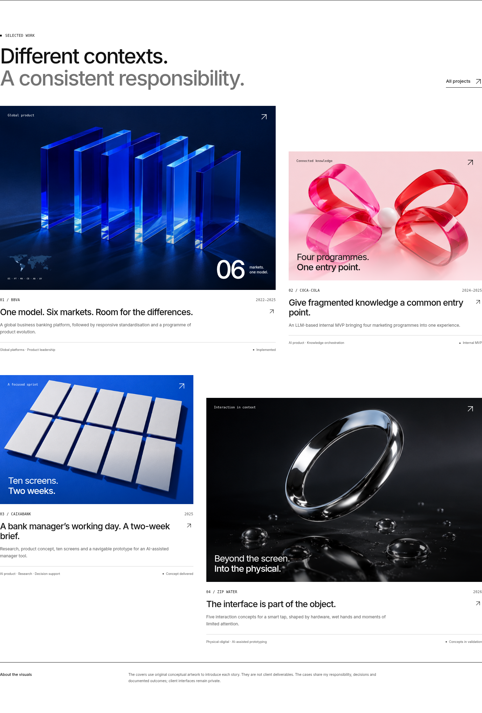
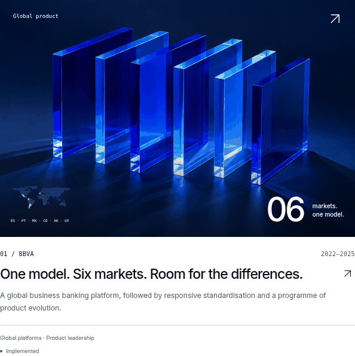
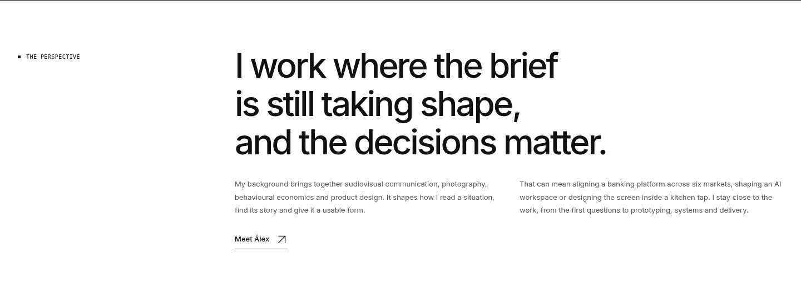
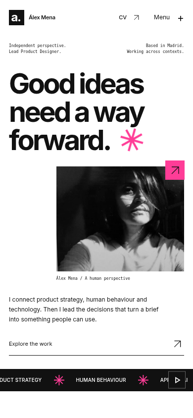

# Portfolio — nueva dirección visual / V2

Una base gráfica en blanco y negro, tipografía sans serif con más presencia, retrato personal, cubiertas conceptuales y una composición de proyectos de distinta escala. El contenido y los hechos de los cinco casos se han conservado.

## Portada

## Proyectos

Las cubiertas usan arte conceptual original creado para este portfolio. No representan productos, pantallas ni entregables de clientes.

## Interacción

La siguiente muestra captura la respuesta de un caso al pasar el cursor: cambia el encuadre y aparece el acceso a la historia. En la web, las acciones también funcionan con teclado. El movimiento automático se puede pausar y respeta la preferencia de movimiento reducido.

## Presentación personal

## Móvil

[Comparar con la primera versión](../README.md)

Estas son capturas y una muestra de interacción para revisar la dirección visual. La web todavía no está desplegada.
