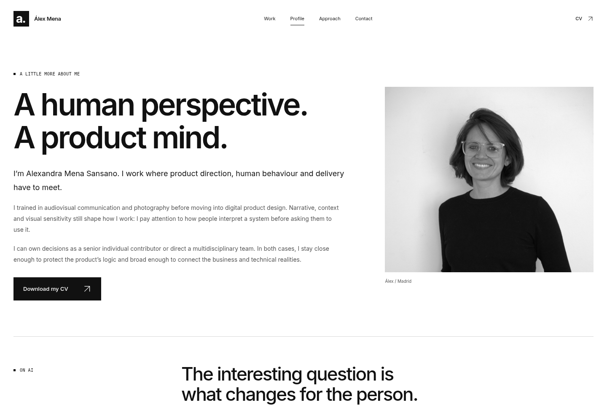
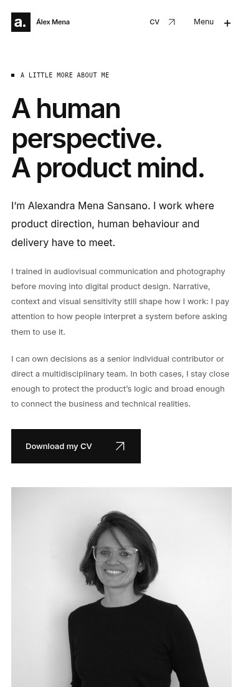

# Portfolio — nueva dirección visual / V2

Una base gráfica en blanco y negro, tipografía sans serif con más presencia, portada tipográfica, cubiertas conceptuales y una composición de proyectos de distinta escala. El contenido y los hechos de los cinco casos se han conservado.

Actualización: la fotografía aparece exclusivamente en Profile. La portada utiliza el titular a todo el ancho, con dos líneas en escritorio y tres en móvil. El retrato facilitado por Alexandra se ha convertido del RAW a una versión web; su encuadre y el blanco y negro se aplican con CSS.

## Portada

## Proyectos

Las cubiertas usan arte conceptual original creado para este portfolio. No representan productos, pantallas ni entregables de clientes.

## Interacción

La siguiente muestra captura la respuesta de un caso al pasar el cursor: cambia el encuadre y aparece el acceso a la historia. En la web, las acciones también funcionan con teclado. El movimiento automático se puede pausar y respeta la preferencia de movimiento reducido.

## Presentación personal

## Perfil con la nueva fotografía

## Móvil

[Comparar con la primera versión](../README.md)

Estas capturas y la muestra de interacción documentan la dirección visual. Se ha preparado una versión navegable en la rama `gh-pages`; necesita que GitHub Pages esté activado para servir esa rama desde `/ (root)`. La dirección esperada es `https://alexmenasansano.github.io/Portfolio/`, pendiente de comprobar tras la activación.
